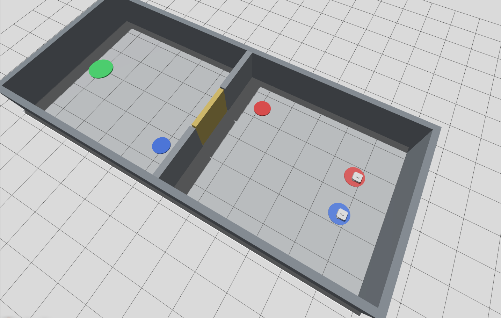

# Escape Maze: Multi-Robot Gazebo Environment

A Gazebo Harmonic + ROS 2 Jazzy simulation of a two-room escape maze for multi-robot coordination.

- **Robots:** two TurtleBot3 robots, one red and one blue.
- **Switches:** colored floor switches. A switch reacts only to a robot of its own color.
- **Gate:** a lift gate between the two rooms opens while a matching robot holds one of the switches.
- **Goal:** the robots must cooperate (one holds a switch while the other crosses) to reach the exit.



## What is included

- **Maze world:** `worlds/escape_maze.sdf`
  - two rooms with collision walls;
  - one vertical lift gate (D1) on a prismatic joint with a position controller;
  - red and blue switch pads, robot start markers and an exit marker.
- **Scenario file:** `config/scenario.yaml`. It is the single place that defines the robots and their colors, switches (color, `hold`/`latch`, position), door rules (`any_of`/`all_of`), the exit and what the robots know at the start.
- **Switch manager:** `scripts/switch_manager.py`. It reads the robots' true positions from Gazebo, applies the switch and door rules, and opens or closes the gate. It includes a self-test for the rules that runs without Gazebo.
- **One-command launcher:** `scripts/run.sh`. It starts Gazebo, spawns the robots from the scenario file and starts the switch manager.
- **Test helpers:** `scripts/test_helpers.sh`. Ready-made test sequences, robot teleport and keyboard driving.

## Requirements

- Ubuntu 24.04, ROS 2 Jazzy, Gazebo Harmonic
- Packages:

```bash
sudo apt install ros-jazzy-ros-gz ros-jazzy-nav2-minimal-tb3-sim ros-jazzy-teleop-twist-keyboard \
                 python3-gz-transport13 python3-gz-msgs10 python3-yaml
```

The scripts use the system Python (`/usr/bin/python3`), which has the Gazebo Python bindings.

## Repository structure

```
.
├── config/
│   └── scenario.yaml          # robots, switches, door rules, exit
├── docs/
│   └── maze_overview.png      # screenshot of the maze
├── scripts/
│   ├── run.sh                 # start everything with one command
│   ├── switch_manager.py      # switch and door logic (+ --selftest)
│   └── test_helpers.sh        # test_a, test_b, setpose, drive_red, drive_blue
├── worlds/
│   └── escape_maze.sdf        # the Gazebo world
└── README.md
```

## The maze

| Element | Position (x, y) in m | Details |
|---|---|---|
| Red robot `robot_red` | (−4.8, −0.65) | Start room |
| Blue robot `robot_blue` | (−4.8, 0.65) | Start room |
| Switch `S_R` | (−1.1, −1.45) | Red, **hold**, start room next to the gate |
| Switch `S_B` | (1.1, 1.45) | Blue, **hold**, far room next to the gate |
| Gate `D1` | (0, 0) | Opens if `S_R` **or** `S_B` is ON (`any_of`) |
| Exit | (5.1, 0) | Far room |

The rooms are 12 m × 5 m inside, split by a wall with a 1.6 m doorway that holds the gate.

### Rules

| Rule | Meaning |
|---|---|
| On a switch | The robot's center is within `on_pad_radius_m` (0.30 m) of the pad center |
| Color | A switch is pressed only by a robot of the **same** color |
| `hold` switch | ON only while a matching robot stands on it |
| `latch` switch | ON from the first press, and stays ON |
| `any_of` door | Open when at least one listed switch is ON |
| `all_of` door | Open when every listed switch is ON |

The intended solution is a handoff:
1. Red holds `S_R`, so the gate opens.
2. Blue crosses and holds `S_B`.
3. Red leaves `S_R` and crosses. The gate stays open because blue holds `S_B`.
4. Both robots go to the exit.

## How it works

The switch manager runs this loop 10 times per second:

```
1. Read every robot's true position from Gazebo        (/world/escape_maze/pose/info)
2. For each switch: which robots are on it?  Is it ON?  (on-pad radius, color, hold/latch)
3. For each door: should it be open?                    (any_of / all_of)
4. Send the gate position to Gazebo                     (/maze/door/D1/position: 1.3 open, 0.0 closed)
```

- **Gazebo side:** the gate's `JointPositionController` moves the panel to the commanded height.
- **Open height:** at 1.3 m the panel's bottom edge is far above the robot and its LiDAR.
- **Gravity:** the gate panel has gravity turned off, so the controller reaches the commanded height exactly.
- **Logging:** the manager prints a line whenever a switch or door changes state.

## Quick start

**Terminal A: start everything.** Ctrl+C stops it all.

```bash
cd escape_maze_gazebo                 # the repository root
./scripts/run.sh                      # with the Gazebo window
./scripts/run.sh --headless           # or: without a window
```

`run.sh` does three things, then shows the switch manager's output:
1. Starts Gazebo with the maze.
2. Spawns every robot from `config/scenario.yaml` at its start position, waiting until each robot is in Gazebo.
3. Starts the switch manager.

Each run's logs are saved in `logs/run_<date>_<time>/`.

**Terminal B: run the tests.** Use `source`, not `./`.

```bash
cd escape_maze_gazebo
source scripts/test_helpers.sh
test_a        # one switch, and the color check
test_b        # the hold-and-handoff
```

Watch Terminal A and the gate in Gazebo while the tests run.

## Testing

### Rule self-test (no Gazebo)

```bash
python3 scripts/switch_manager.py --selftest     # ends with: ALL PASS (13 checks)
```

### Test A: one switch, and the color check (`test_a`)

| Step | Terminal A prints | Gate |
|---|---|---|
| Red robot onto the red switch `S_R` | `switch S_R (red hold) -> ON`, then `door D1 -> OPEN` | Rises |
| Red robot steps off | `switch S_R (red hold) -> OFF`, then `door D1 -> CLOSED` | Drops |
| Blue robot onto the **red** switch | Nothing (wrong color) | Stays closed |
| Blue robot back to start | Nothing | Stays closed |

### Test B: hold-and-handoff (`test_b`)

| Step | Terminal A prints | Gate |
|---|---|---|
| Red holds `S_R` | `switch S_R (red hold) -> ON`, then `door D1 -> OPEN` | Rises |
| Blue holds `S_B` on the far side | `switch S_B (blue hold) -> ON` | Stays open |
| Red leaves `S_R` and crosses | `switch S_R (red hold) -> OFF` | **Stays open** (blue holds `S_B`) |
| Blue leaves `S_B` | `switch S_B (blue hold) -> OFF`, then `door D1 -> CLOSED` | Drops |

Expected output in Terminal A for Test B (times will differ):

```
[   0.00s] switch manager up; world=escape_maze; watching robots ['robot_red', 'robot_blue']
[   7.02s] switch S_R (red hold) -> ON
[   7.02s] door D1 -> OPEN
[  10.73s] switch S_B (blue hold) -> ON
[  14.24s] switch S_R (red hold) -> OFF
[  17.64s] switch S_B (blue hold) -> OFF
[  17.64s] door D1 -> CLOSED
```

### Other test commands (after `source scripts/test_helpers.sh`)

```bash
reset_robots                      # both robots back to their start positions
setpose robot_red -1.1 -1.45      # teleport one robot to (x, y)
drive_red                         # drive the red robot with the keyboard (Ctrl+C to stop)
drive_blue                        # drive the blue robot
```

`setpose` teleports a robot, which is useful for testing the switch logic. To show a real crossing, open the gate (red on `S_R`) and drive blue through it with `drive_blue`.

## Running each part manually

The same as `run.sh`, one terminal per part. Run every terminal from the repository root.

```bash
# Terminal 1: Gazebo. Run the export before gz sim, or the robot meshes won't load.
source /opt/ros/jazzy/setup.bash
export GZ_SIM_RESOURCE_PATH=/opt/ros/jazzy/share/nav2_minimal_tb3_sim/models:/opt/ros/jazzy/share
gz sim -r worlds/escape_maze.sdf

# Terminal 2: red robot. robot_name must match the robot id in config/scenario.yaml.
source /opt/ros/jazzy/setup.bash
ros2 launch nav2_minimal_tb3_sim spawn_tb3.launch.py namespace:=robot_red robot_name:=robot_red x_pose:=-4.8 y_pose:=-0.65

# Terminal 3: blue robot
source /opt/ros/jazzy/setup.bash
ros2 launch nav2_minimal_tb3_sim spawn_tb3.launch.py namespace:=robot_blue robot_name:=robot_blue x_pose:=-4.8 y_pose:=0.65

# Terminal 4: switch manager
python3 scripts/switch_manager.py config/scenario.yaml
```

To move the gate by hand, run this with the switch manager **stopped**; otherwise it overrides the command 10 times per second:

```bash
gz topic -t /maze/door/D1/position -m gz.msgs.Double -p 'data: 1.3'   # open
gz topic -t /maze/door/D1/position -m gz.msgs.Double -p 'data: 0.0'   # close
```

## Configuration

Edit `config/scenario.yaml`. No code changes are needed for:

| To change | Field |
|---|---|
| How close a robot must be to press a switch | `scenario.on_pad_radius_m` |
| A switch's type | `switches[].mode`: `hold` or `latch` |
| A door's rule | `doors[].logic`: `any_of` or `all_of`; `doors[].requires`: switch ids |
| Gate open height | `doors[].open_joint_position_m` (max 1.3, the joint limit in the SDF) |
| Robot start positions | `robots[].start_pose` (used by `run.sh`) |

If you move a switch or the exit in the scenario, move its marker in `worlds/escape_maze.sdf` to match.

## Troubleshooting

| Symptom | Fix |
|---|---|
| Terminal A shows nothing after `switch manager up` | Normal. It prints only when a switch or door changes; move a robot onto a switch |
| `waiting for robot poses: [...]` keeps printing | The spawn `robot_name` must match the robot `id` in the scenario, and `gz_world_name` must match `<world name>` in the SDF |
| `a Gazebo world named 'escape_maze' is already running` | Close the other Gazebo first (or `pkill -f 'gz sim'`) |
| `ModuleNotFoundError: No module named 'gz'` | Use the system `python3` (`/usr/bin/python3`), not a conda or venv Python |
| Robots appear without meshes | Run the `export GZ_SIM_RESOURCE_PATH=...` line before `gz sim` |
| `setpose: command not found` | Run `source scripts/test_helpers.sh` in that terminal first |
| A robot on a switch does nothing | Check the colors: red presses only `S_R` (−1.1, −1.45); blue presses only `S_B` (1.1, 1.45) |
