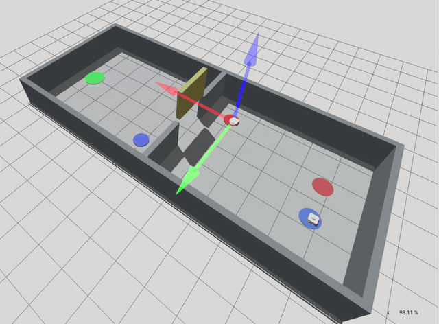

# Escape Maze: Multi-Robot Gazebo Environment

A Gazebo Harmonic + ROS 2 Jazzy simulation of a two-room escape maze for multi-robot coordination.

- **Robots:** two TurtleBot3 robots, one red and one blue.
- **Switches:** colored floor switches. A switch reacts only to a robot of its own color.
- **Gate:** a lift gate between the two rooms opens while a matching robot holds one of the switches.
- **Goal:** the robots must cooperate (one holds a switch while the other crosses) to reach the exit.
- **Autonomy:** a planner (rule-based baseline or SMART-LLM) assigns one task per robot, and an executor drives each robot with Nav2.


## Demo



▶ [Full video (MP4, 41 s)](docs/gate_demo.mp4)

The robots are moved onto the switches with Gazebo's move tool. When a robot stands on a switch of its own color, the switch manager lifts gate D1. When no matching robot holds a switch, the gate closes.

## What is included

- **Maze world:** `worlds/escape_maze.sdf`
  - two rooms with collision walls;
  - one vertical lift gate (D1) on a prismatic joint with a position controller;
  - red and blue switch pads, robot start markers and an exit marker.
- **Scenario file:** `config/scenario.yaml`. It is the single place that defines the robots and their colors, switches (color, `hold`/`latch`, position), door rules (`any_of`/`all_of`), the exit and what the robots know at the start.
- **Switch manager:** `scripts/switch_manager.py`. It reads the robots' true positions from Gazebo, applies the switch and door rules, and opens or closes the gate. It includes a self-test for the rules that runs without Gazebo.
- **World state for the planners:** `scripts/world_state.py`. The switch manager uses it to publish what the team knows (rooms, robots, switches, doors, tasks and path costs) as JSON on `/team/world_state`, in the format of `docs/communication_standards.md`.
- **Navigation:** `launch/navigation.launch.py` with `config/nav2_params.yaml`. Nav2 for every robot in the scenario, each in its own namespace (`/robot1/navigate_to_pose`, ...).
- **Executor:** `scripts/executor.py`. Turns each robot's task from `/team/plan` into Nav2 goals and reports each robot's task and status on `/team/robot_status`.
- **Planners:** both publish `/team/plan` from `/team/world_state`, so either one drives the same executor.
  - `scripts/baseline_planner.py`: a small rule-based (greedy) planner, a stand-in for the conventional planner.
  - `smart_llm_planner/`: the SMART-LLM planner (Gemini), a ROS 2 package with its own tests.
- **One-command launcher:** `scripts/run.sh`. It starts Gazebo, spawns the robots from the scenario file and starts the switch manager; with `--planner` also Nav2, the executor and a planner.
- **Test helpers:** `scripts/test_helpers.sh`. Ready-made test sequences, robot teleport, keyboard driving and hand-written plans.

## Requirements

- Ubuntu 24.04, ROS 2 Jazzy, Gazebo Harmonic
- Packages:

```bash
sudo apt install ros-jazzy-ros-gz ros-jazzy-nav2-minimal-tb3-sim ros-jazzy-navigation2 \
                 ros-jazzy-teleop-twist-keyboard python3-gz-transport13 python3-gz-msgs10 python3-yaml
```

- **SMART-LLM planner only:** the Gemini library and an API key.

```bash
/usr/bin/python3 -m pip install --user --break-system-packages google-genai   # installs into ~/.local only
export GEMINI_API_KEY=<your key>     # in the terminal that runs run.sh; never commit a key
```

The scripts use the system Python (`/usr/bin/python3`), which has the Gazebo Python bindings.

## Repository structure

```
.
├── config/
│   ├── scenario.yaml          # robots, switches, door rules, exit
│   └── nav2_params.yaml       # Nav2 parameters for one robot
├── docs/
│   ├── communication_standards.md  # world-state and plan formats, naming
│   ├── maze_overview.png      # screenshot of the maze
│   ├── gate_demo.gif          # demo animation (plays in this README)
│   └── gate_demo.mp4          # full demo video
├── launch/
│   └── navigation.launch.py   # Nav2 for every robot in the scenario
├── scripts/
│   ├── run.sh                 # start everything with one command
│   ├── switch_manager.py      # switch and door logic (+ --selftest)
│   ├── world_state.py         # world state for the planners (+ --selftest, --demo)
│   ├── executor.py            # /team/plan -> Nav2 goals (+ --selftest)
│   ├── baseline_planner.py    # rule-based planner (+ --selftest)
│   └── test_helpers.sh        # test_a, test_b, setpose, drive_red, drive_blue, send_plan
├── smart_llm_planner/         # SMART-LLM planner (ROS 2 package, Gemini)
├── worlds/
│   └── escape_maze.sdf        # the Gazebo world
├── CONTRIBUTING.md            # team Git workflow
└── README.md
```

## The maze

| Element | Position (x, y) in m | Details |
|---|---|---|
| Red robot `robot1` | (−4.8, −0.65) | Start room |
| Blue robot `robot2` | (−4.8, 0.65) | Start room |
| Switch `S1` | (−1.1, −1.45) | Red, **hold**, start room next to the gate |
| Switch `S2` | (1.1, 1.45) | Blue, **hold**, far room next to the gate |
| Gate `D1` | (0, 0) | Opens if `S1` **or** `S2` is ON (`any_of`) |
| Exit | (5.1, 0) | Far room |

The rooms are 12 m × 5 m inside, split by a wall with a 1.6 m doorway that holds the gate.

### Rules

| Rule | Meaning |
|---|---|
| On a switch | The robot's center is within `on_pad_radius_m` (0.30 m) of the pad center |
| Color | A switch is pressed only by a robot of the **same** color |
| `hold` switch | ON only while a matching robot stands on it |
| `latch` switch | ON from the first press, and stays ON |
| `any_of` door | Open when at least one listed switch is ON |
| `all_of` door | Open when every listed switch is ON |

The intended solution is a handoff:
1. Red holds `S1`, so the gate opens.
2. Blue crosses and holds `S2`.
3. Red leaves `S1` and crosses. The gate stays open because blue holds `S2`.
4. Both robots go to the exit.

## How it works

The switch manager runs this loop 10 times per second:

```
1. Read every robot's true position from Gazebo        (/world/escape_maze/pose/info)
2. For each switch: which robots are on it?  Is it ON?  (on-pad radius, color, hold/latch)
3. For each door: should it be open?                    (any_of / all_of)
4. Send the gate position to Gazebo                     (/maze/door/D1/position: 1.3 open, 0.0 closed)
5. Update what the team knows and publish it            (/team/world_state, JSON)
```

- **Gazebo side:** the gate's `JointPositionController` moves the panel to the commanded height.
- **Open height:** at 1.3 m the panel's bottom edge is far above the robot and its LiDAR.
- **Gravity:** the gate panel has gravity turned off, so the controller reaches the commanded height exactly.
- **Logging:** the manager prints a line whenever a switch or door changes state, and whenever the known rooms or tasks change.

### World state (`/team/world_state`)

The planners never see the true maze. They see only what the team has discovered:

| Rule | Meaning |
|---|---|
| Discovery | A room becomes known when a robot enters it, and stays known. Everything inside it (switches, the exit) becomes known with it |
| Doors | A door is known when one of its rooms is known. Until the other room is entered, its `other_room` is `"UNKNOWN"` |
| No leaks | A switch's `controls` and a door's `open_if` list only known doors and switches. `open_if` is `null` while the known switches can't open the door: none known (`any_of`), or not all known (`all_of`). It is also `null` for a door that needs no switch |
| Tasks | `ACTIVATE:<S>` (latch, not yet on), `HOLD:<S>`, `CROSS:<D>` for every known door, and `EXIT` once the exit is known. Exploring a new room means crossing a door that leads to `UNKNOWN`. A `CROSS` task's `depends` lists the HOLD tasks that can keep its door open (`any_of`: any one is enough; `all_of`: all are needed). It is `null` if latched switches already keep the door open |
| Costs | Shortest path length (m) from each robot to each task's target on the known map. A path goes **through** a door only if the door stays open with nobody standing on a switch (it needs no switch, or latched switches keep it open). A door that a robot holds open is reached only as the target of `CROSS:<D>`, which the planner must pair with a `HOLD`. A missing entry means the target is unreachable now |

Message details:
- **Type and format:** a `std_msgs/String` holding the JSON from `docs/communication_standards.md`, with the keys `rooms`, `robots`, `switches`, `doors`, `tasks` and `costs`.
- **When it is sent:** at once when anything except the costs changes; at most every 0.5 s while only the costs change (robots moving); and at least every 2 s in any case.
- **QoS:** the publisher is transient-local. A node that subscribes with `durability=TRANSIENT_LOCAL` receives the latest state as soon as it starts.

```bash
ros2 topic echo /team/world_state --once --field data
```

## Planning and execution

```
switch manager --/team/world_state--> planner --/team/plan--> executor --Nav2 goals--> robots
      ^                                                          |
      +------------------------/team/robot_status----------------+
```

| Topic | From -> to | Content (`std_msgs/String`, JSON) | QoS |
|---|---|---|---|
| `/team/world_state` | switch manager -> planners, executor | What the team knows (see above) | transient local, re-sent at least every 2 s |
| `/team/plan` | planner -> executor | One task per robot, e.g. `{"robot1": "HOLD:S1", "robot2": "CROSS:D1"}`; `WAIT` for an idle robot | volatile. `run.sh` starts the executor before the planner; an executor started later gets the next plan (the baseline re-sends its plan every 5 s, SMART-LLM replans at least every 20 s) |
| `/team/robot_status` | executor -> switch manager | Each robot's `task` and `status` (`ok` / `waiting`, `waiting_for`); they appear in the world state's `robots` | transient local, re-sent every 1 s |
| `/team/planner_log` | planner -> logs | One record per planning call: assignments and reasons (SMART-LLM also logs each stage's output and timing) | volatile |

**What the executor does with each task:**

| Task | The robot | Done when |
|---|---|---|
| `ACTIVATE:<S>` | drives onto the switch pad | the switch is on |
| `HOLD:<S>` | drives onto the pad and stays | never; the planner gives it another task |
| `CROSS:<D>` | drives through the door into the room on the other side. If the door is closed, it waits in front of it with status `waiting` until it opens. Works the same when the other side is `UNKNOWN` (exploring) | its center is 0.6 m past the door |
| `EXIT` | parks next to the exit, keeping clear of other robots | it is there |
| `WAIT` | stops | |

- **Done:** when a task is done, the robot's `task` goes back to `null`, which tells the planner to replan.
- **Repeats:** a task that is sent again keeps the current goal, and a finished task that is sent again is ignored.
- **Safety:** a robot holding a switch does not leave it while another robot is in the opening of a door that the switch alone keeps open, whatever the plan says; it takes its next task once the doorway is clear.
- **Geometry:** the executor drives the real robots, so it uses the true door and room geometry from `config/scenario.yaml`. The planners only see the world state.

**Navigation:** Nav2 runs once per robot, in the robot's namespace. There is no map server and no AMCL:
- **Localization:** a fixed transform `map -> odom` (the robot's start pose) plus wheel odometry. The `map` frame is the Gazebo world frame.
- **Costmaps:** built from each robot's own LiDAR. Space nobody has scanned yet counts as free, so a path can lead into an unexplored room. A closed gate is seen and blocks the path; a lifted gate does not.

**Planners:**
- **`--planner conventional`:** `scripts/baseline_planner.py`, a small rule-based planner and a stand-in for the team's conventional planner. Each robot heads for the first door on its route to the exit room (or, while the exit is unknown, the nearest door to an `UNKNOWN` room). Free robots of the right color are sent to that door's switches, and a robot holding a door open keeps holding it until another switch takes over (the handoff). Its plans follow the same rules as the SMART-LLM validator: every robot gets a task, one robot per task except `EXIT`/`WAIT`, colors match, and every crossed door is kept open by the plan.
- **`--planner smart_llm`:** `smart_llm_planner/` (SMART-LLM with Gemini). It needs `GEMINI_API_KEY` and the `google-genai` library (see Requirements); `run.sh` checks both before it starts anything.

## Quick start

**Terminal A: start everything.** Ctrl+C stops it all.

```bash
cd escape_maze_gazebo                 # the repository root
./scripts/run.sh                      # with the Gazebo window; move the robots yourself
./scripts/run.sh --headless           # or: without a window
```

**The robots solve the maze on their own.** Pick a planner:

```bash
./scripts/run.sh --planner conventional      # rule-based baseline planner
export GEMINI_API_KEY=<your key>
./scripts/run.sh --planner smart_llm         # SMART-LLM planner (Gemini)
./scripts/run.sh --nav                       # Nav2 + executor only; send plans by hand (send_plan)
```

Add `--headless` to any of these to run without a window.

`run.sh` starts these, then shows their output:
1. Gazebo with the maze.
2. Every robot from `config/scenario.yaml` at its start position, waiting until each robot is in Gazebo.
3. The switch manager.
4. With `--planner` or `--nav`: Nav2 for every robot (waiting until it is active), then the executor (lines start with `[executor]`).
5. With `--planner`: the planner (lines start with `[planner]`).

With `--planner conventional` on the default scenario, a run looks like this (times will differ; about one minute from the first plan to both robots at the exit):

```
[planner] plan: robot1 HOLD:S1 (opens D1 for robot2), robot2 CROSS:D1 (crosses D1 once it opens)
[  22.53s] switch S1 (red hold) -> ON
[  22.53s] door D1 -> OPEN
[  28.76s] world state: rooms known ['1,1', '1,2']; tasks ['HOLD:S1', 'HOLD:S2', 'CROSS:D1', 'EXIT']
[executor] robot2: CROSS:D1 done
[planner] plan: robot1 HOLD:S1 (holds S1 until another switch keeps D1 open, then crosses), robot2 HOLD:S2 (opens D1 for robot1)
[  39.53s] switch S2 (blue hold) -> ON
[planner] plan: robot1 CROSS:D1 (D1 is open), robot2 HOLD:S2 (keeps D1 open for robot1)
[  42.75s] switch S1 (red hold) -> OFF
[executor] robot1: CROSS:D1 done
[planner] plan: robot1 EXIT (in the exit room), robot2 EXIT (in the exit room)
[  53.21s] switch S2 (blue hold) -> OFF
[  53.21s] door D1 -> CLOSED
[executor] all robots are at the exit
```

Each run's logs are saved in `logs/run_<date>_<time>/`.

The launcher and test helpers default to `GZ_IP=127.0.0.1` so Gazebo's GUI,
server and robot processes can discover each other on this computer. This avoids
startup hangs with automatic network-interface selection. If you use multiple
computers, set `GZ_IP` to this computer's reachable network address in every
terminal instead.

**Terminal B: run the tests.** Use `source`, not `./`.

```bash
cd escape_maze_gazebo
source scripts/test_helpers.sh
test_a        # one switch, and the color check
test_b        # the hold-and-handoff
```

Watch Terminal A and the gate in Gazebo while the tests run.

## Testing

### Rule self-test (no Gazebo)

```bash
python3 scripts/switch_manager.py --selftest     # 17 checks; the last line is ALL PASS
```

### Executor and planner self-tests (no ROS or Gazebo)

```bash
python3 scripts/executor.py --selftest           # task ids, crossing, waiting, holder safety, exit spots
python3 scripts/baseline_planner.py --selftest   # the handoff step by step, and special cases
cd smart_llm_planner && python3 -m pytest -q test && cd ..   # SMART-LLM planner (no API key needed)
```

### World-state self-test (no Gazebo)

```bash
python3 scripts/world_state.py --selftest   # 17 checks (discovery, no leaks, tasks, costs); the last line is ALL PASS
python3 scripts/world_state.py --demo       # prints the JSON at the start and during the handoff
```

### Test A: one switch, and the color check (`test_a`)

| Step | Terminal A prints | Gate |
|---|---|---|
| Red robot onto the red switch `S1` | `switch S1 (red hold) -> ON`, then `door D1 -> OPEN` | Rises |
| Red robot steps off | `switch S1 (red hold) -> OFF`, then `door D1 -> CLOSED` | Drops |
| Blue robot onto the **red** switch | Nothing (wrong color) | Stays closed |
| Blue robot back to start | Nothing | Stays closed |

### Test B: hold-and-handoff (`test_b`)

| Step | Terminal A prints | Gate |
|---|---|---|
| Red holds `S1` | `switch S1 (red hold) -> ON`, then `door D1 -> OPEN` | Rises |
| Blue holds `S2` on the far side | `switch S2 (blue hold) -> ON` | Stays open |
| Red leaves `S1` and crosses | `switch S1 (red hold) -> OFF` | **Stays open** (blue holds `S2`) |
| Blue leaves `S2` | `switch S2 (blue hold) -> OFF`, then `door D1 -> CLOSED` | Drops |

Expected output in Terminal A for Test B (times will differ):

```
[   0.00s] switch manager up; world=escape_maze; watching robots ['robot1', 'robot2']
[   7.02s] switch S1 (red hold) -> ON
[   7.02s] door D1 -> OPEN
[  10.73s] switch S2 (blue hold) -> ON
[  14.24s] switch S1 (red hold) -> OFF
[  17.64s] switch S2 (blue hold) -> OFF
[  17.64s] door D1 -> CLOSED
```

### Other test commands (after `source scripts/test_helpers.sh`)

```bash
reset_robots                      # both robots back to their start positions
setpose robot1 -1.1 -1.45      # teleport one robot to (x, y)
drive_red                         # drive the red robot with the keyboard (Ctrl+C to stop)
drive_blue                        # drive the blue robot
```

`setpose` teleports a robot, which is useful for testing the switch logic. To show a real crossing, open the gate (red on `S1`) and drive blue through it with `drive_blue`.

With Nav2 and the executor running (`run.sh --nav` or `--planner ...`):

```bash
send_plan robot1=HOLD:S1 robot2=CROSS:D1   # the same message a planner sends on /team/plan
show_world_state                           # latest /team/world_state
show_status                                # latest /team/robot_status
show_plan                                  # the next /team/plan
```

Don't teleport robots (`setpose`, `reset_robots`, Gazebo's move tool) while Nav2 runs: odometry doesn't follow a teleport, so Nav2 would drive the robot to the wrong place.

## Running each part manually

The same as `run.sh`, one terminal per part. Run every terminal from the repository root.

```bash
# Terminal 1: Gazebo. Run the export before gz sim, or the robot meshes won't load.
source /opt/ros/jazzy/setup.bash
export GZ_IP=127.0.0.1              # set this in all four terminals
export GZ_SIM_RESOURCE_PATH=/opt/ros/jazzy/share/nav2_minimal_tb3_sim/models:/opt/ros/jazzy/share
gz sim -r worlds/escape_maze.sdf

# Terminal 2: red robot. robot_name must match the robot id in config/scenario.yaml.
source /opt/ros/jazzy/setup.bash
export GZ_IP=127.0.0.1
ros2 launch nav2_minimal_tb3_sim spawn_tb3.launch.py namespace:=robot1 robot_name:=robot1 x_pose:=-4.8 y_pose:=-0.65

# Terminal 3: blue robot
source /opt/ros/jazzy/setup.bash
export GZ_IP=127.0.0.1
ros2 launch nav2_minimal_tb3_sim spawn_tb3.launch.py namespace:=robot2 robot_name:=robot2 x_pose:=-4.8 y_pose:=0.65

# Terminal 4: switch manager
export GZ_IP=127.0.0.1
python3 scripts/switch_manager.py config/scenario.yaml
```

Navigation, executor and planner (each in its own terminal, after `source /opt/ros/jazzy/setup.bash`):

```bash
ros2 launch launch/navigation.launch.py scenario:=config/scenario.yaml   # wait for "Managed nodes are active" per robot
python3 scripts/executor.py config/scenario.yaml
python3 scripts/baseline_planner.py                                       # or the SMART-LLM planner:
PYTHONPATH=$PWD/smart_llm_planner python3 -m smart_llm_planner.planner_node \
    --ros-args --params-file smart_llm_planner/config/smart_llm_planner.yaml
```

To move the gate by hand, run this with the switch manager **stopped**; otherwise it overrides the command 10 times per second:

```bash
gz topic -t /maze/door/D1/position -m gz.msgs.Double -p 'data: 1.3'   # open
gz topic -t /maze/door/D1/position -m gz.msgs.Double -p 'data: 0.0'   # close
```

## Configuration

Edit `config/scenario.yaml`. No code changes are needed for:

| To change | Field |
|---|---|
| How close a robot must be to press a switch | `scenario.on_pad_radius_m` |
| A switch's type | `switches[].mode`: `hold` or `latch` |
| A door's rule | `doors[].logic`: `any_of` or `all_of`; `doors[].requires`: switch ids |
| Gate open height | `doors[].open_joint_position_m` (max 1.3, the joint limit in the SDF) |
| Robot start positions | `robots[].start_pose` (used by `run.sh`) |

If you move a switch or the exit in the scenario, move its marker in `worlds/escape_maze.sdf` to match.

## Troubleshooting

| Symptom | Fix |
|---|---|
| Gazebo hangs at startup; logs show `Waited for 10s for a subscriber to [/gazebo/starting_world]` | Use the updated `run.sh`, or run `export GZ_IP=127.0.0.1` before `gz sim`. Use the same value in terminals running robot spawners, the manager and test commands |
| `Errno::ESRCH` / `No such process` after repeated Ctrl+C | This can happen in Gazebo's shutdown handler when a process is already gone. Press Ctrl+C once and allow shutdown to finish; check earlier log messages for the startup failure |
| Terminal A shows nothing after the first `world state:` line | Normal. It prints only when a switch, a door, the known rooms or the tasks change; move a robot onto a switch |
| A planner receives no `/team/world_state` at startup | Subscribe with `durability=TRANSIENT_LOCAL` to get the latest state at once; otherwise the next one arrives within 2 s. Both ends need the same `ROS_DOMAIN_ID` |
| `scenario problem: ...` and `world state off` at startup | Every door needs `pose` and `connects` (two room ids from `rooms`), and every switch and the exit must lie inside exactly one room. The gates still work; fix `config/scenario.yaml` and restart |
| `waiting for robot poses: [...]` keeps printing | The spawn `robot_name` must match the robot `id` in the scenario, and `gz_world_name` must match `<world name>` in the SDF |
| `a Gazebo world named 'escape_maze' is already running` | Close the other Gazebo first (or `pkill -f 'gz sim'`) |
| `ModuleNotFoundError: No module named 'gz'` | Use the system `python3` (`/usr/bin/python3`), not a conda or venv Python |
| Robots appear without meshes | Run the `export GZ_SIM_RESOURCE_PATH=...` line before `gz sim` |
| `setpose: command not found` | Run `source scripts/test_helpers.sh` in that terminal first |
| A robot on a switch does nothing | Check the colors: red presses only `S1` (−1.1, −1.45); blue presses only `S2` (1.1, 1.45) |
| `timed out ... waiting for Nav2 to become active` | Check `logs/run_.../navigation.log`. Nav2 needs the robots' odometry and LiDAR from the spawn bridge, so look in `spawn_<robot>.log` too |
| ROS 2 nodes don't receive each other's messages (planner gets no world state, executor gets no plan) | All terminals need the same `ROS_DOMAIN_ID`. On machines with VPN or virtual network interfaces, also run `export ROS_AUTOMATIC_DISCOVERY_RANGE=LOCALHOST` in every terminal |
| `--planner smart_llm needs a Gemini API key` / `needs the Gemini library` | See Requirements. Set the key with `export GEMINI_API_KEY=...` in the terminal; never write it into a file in the repository |
| A robot drives to the wrong place after a teleport | Odometry doesn't follow teleports. Restart `run.sh` and don't teleport while Nav2 runs |
| A robot waits in front of a closed door (`waiting at closed D1`) | Normal: the plan asks it to cross, and the door opens once another robot holds a switch. If no plan does that, the planner has no way to open it yet |

## Contributing

Team members: see [CONTRIBUTING.md](CONTRIBUTING.md) for the branch and Pull Request workflow.
